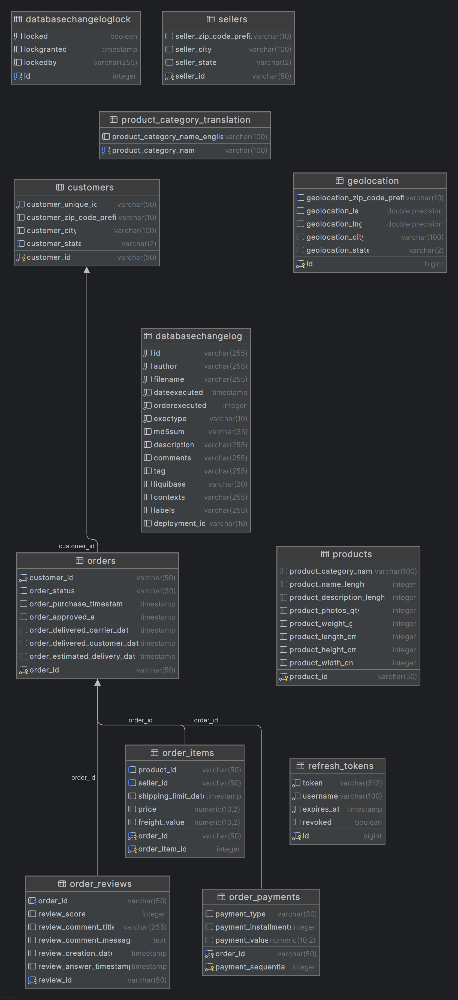

# Quarkus DDD — Olist E-Commerce API


API RESTful reativa construída com **Quarkus**, seguindo os princípios de **Domain-Driven Design (DDD)**, com segurança via **Keycloak + JWT**, gerenciamento de segredos com **HashiCorp Vault**, versionamento de banco com **Liquibase**, e documentação interativa via **Swagger UI**.

Os dados utilizados são do dataset público **Olist Brazilian E-Commerce** (Kaggle), importados automaticamente via Liquibase na inicialização.

---

## Índice

- [Visão Geral](#visão-geral)
- [Stack Tecnológica](#stack-tecnológica)
- [Arquitetura DDD](#arquitetura-ddd)
- [Estrutura do Projeto](#estrutura-do-projeto)
- [Pré-requisitos](#pré-requisitos)
- [Configuração e Execução](#configuração-e-execução)
- [Variáveis de Ambiente e Vault](#variáveis-de-ambiente-e-vault)
- [Gerenciamento de Usuários](#gerenciamento-de-usuários)
- [Segurança — Keycloak e JWT](#segurança--keycloak-e-jwt)
- [Endpoints da API](#endpoints-da-api)
- [Swagger UI — Como Usar](#swagger-ui--como-usar)
- [HATEOAS — Nível 3 de Maturidade](#hateoas--nível-3-de-maturidade)
- [Rate Limiting](#rate-limiting)
- [Refresh Token](#refresh-token)
- [Modelo de Dados — DER](#modelo-de-dados--der)
- [Liquibase — Versionamento do Banco](#liquibase--versionamento-do-banco)
- [Testes](#testes)
- [Docker e Docker Compose](#docker-e-docker-compose)
- [Kubernetes](#kubernetes)
- [Terraform — AWS / Azure / GCP](#terraform--aws--azure--gcp)
- [Boas Práticas Aplicadas](#boas-práticas-aplicadas)

---

## Visão Geral

```
┌─────────────────────────────────────────────────────────────────┐
│                        Cliente (HTTP)                           │
└───────────────────────────┬─────────────────────────────────────┘
                            │
                    ┌───────▼────────┐
                    │  Rate Limiter  │  (100 req/min por IP)
                    └───────┬────────┘
                            │
                    ┌───────▼────────┐
                    │  JWT Filter    │  (Keycloak OIDC)
                    └───────┬────────┘
                            │
              ┌─────────────▼──────────────┐
              │     interfaces/rest         │  REST Resources (JAX-RS)
              │  AuthResource               │  HATEOAS Level 3
              │  CustomerResource           │
              │  OrderResource              │
              │  OrderItemResource          │
              │  OrderPaymentResource       │
              │  OrderReviewResource        │
              │  ProductResource            │
              │  SellerResource             │
              │  GeolocationResource        │
              │  UserResource               │
              │  HealthResource             │
              └─────────────┬──────────────┘
                            │
              ┌─────────────▼──────────────┐
              │     application/service     │  Use Cases
              │  AuthService                │
              │  CustomerService            │
              │  OrderService               │
              │  OrderItemService           │
              │  OrderPaymentService        │
              │  OrderReviewService         │
              │  ProductService             │
              │  SellerService              │
              │  GeolocationService         │
              └─────────────┬──────────────┘
                            │
        ┌───────────────────┼───────────────────┐
        │                   │                   │
┌───────▼──────┐  ┌─────────▼──────┐  ┌────────▼───────┐
│ domain/model │  │domain/repository│  │domain/exception│
│  Entities    │  │  Interfaces     │  │  BusinessEx    │
└──────────────┘  └─────────┬──────┘  └────────────────┘
                            │
              ┌─────────────▼──────────────┐
              │  infrastructure/repository  │  Panache Reactive
              │  infrastructure/security    │  Keycloak Client
              │  infrastructure/ratelimit   │  ContainerRequestFilter
              │  infrastructure/config      │  OpenAPI, ExMapper
              └─────────────┬──────────────┘
                            │
              ┌─────────────▼──────────────┐
              │       PostgreSQL            │  Reactive PG Client
              │       Vault                 │  Secrets
              │       Keycloak              │  OIDC / JWT
              └────────────────────────────┘
```

---

## Stack Tecnológica

| Tecnologia | Versão | Função |
|---|---|---|
| Java | 21 | Linguagem principal |
| Quarkus | 3.40.1 | Framework principal |
| Hibernate Reactive + Panache | BOM 3.40.1 | ORM reativo |
| Hibernate Validator | BOM 3.40.1 | Bean Validation (Jakarta) |
| Reactive PostgreSQL Client | BOM 3.40.1 | Driver reativo |
| JDBC PostgreSQL | BOM 3.40.1 | Driver síncrono (Liquibase) |
| Liquibase | BOM 3.40.1 | Versionamento de banco |
| Keycloak | 24.0.1 | Identity Provider (OIDC) |
| SmallRye JWT | BOM 3.40.1 | Validação de tokens JWT |
| HashiCorp Vault | 1.15 | Gerenciamento de segredos |
| Quarkiverse Vault | 4.2.1 | Extensão Quarkus para Vault |
| SmallRye OpenAPI | BOM 3.40.1 | Documentação Swagger |
| SmallRye Fault Tolerance | BOM 3.40.1 | Resiliência |
| Quarkus Scheduler | BOM 3.40.1 | Agendamento de tarefas |
| PostgreSQL | 14 | Banco de dados |
| Docker / Compose | latest | Containerização |
| Gradle | 9.7.0 | Build tool |

---

## Arquitetura DDD

O projeto segue a arquitetura **Domain-Driven Design** com quatro camadas bem definidas:

### `domain/`
Núcleo do negócio. Não depende de nenhuma outra camada.
- **model/** — Entidades JPA (`Customer`, `Order`, `OrderItem`, `OrderItemId`, `OrderPayment`, `OrderPaymentId`, `OrderReview`, `Product`, `Seller`, `RefreshToken`)
- **repository/** — Interfaces de repositório (contratos)
- **exception/** — Exceções de domínio (`ResourceNotFoundException`, `BusinessException`)

### `application/`
Orquestra os casos de uso. Depende apenas do `domain/`.
- **service/** — Serviços de aplicação com `@WithSession` (leitura) e `@WithTransaction` (escrita)
- **dto/request/** — Objetos de entrada validados com Bean Validation
- **dto/response/** — Objetos de saída com links HATEOAS (`PageResponse<T>`, `Link`, `TokenResponse`)
- **mapper/** — Conversão entre domínio e DTOs

### `infrastructure/`
Implementações técnicas. Depende do `domain/`.
- **repository/** — Implementações Panache Reactive dos repositórios
- **security/** — Cliente Keycloak para troca de tokens (`KeycloakAuthService`, `KeycloakTokenClient`)
- **ratelimit/** — Filtro JAX-RS de Rate Limiting (`RateLimitFilter`)
- **config/** — OpenAPI config, Exception Mapper global

### `interfaces/`
Ponto de entrada HTTP. Depende do `application/`.
- **rest/** — Resources JAX-RS com anotações OpenAPI e segurança por roles

---

## Estrutura do Projeto

```
quarkus-ddd/
├── data/                                    # CSVs do dataset Olist (referência)
├── docker/
│   └── init-db.sql
├── keycloak/
│   └── conf/
│       └── realm-export.json
├── src/
│   ├── main/
│   │   ├── java/br/com/
│   │   │   ├── domain/
│   │   │   ├── application/
│   │   │   ├── infrastructure/
│   │   │   ├── interfaces/
│   │   │   └── HealthResource.java
│   │   └── resources/
│   │       ├── application.properties
│   │       ├── data/                        # CSVs no classpath (Liquibase)
│   │       └── db/changelog/
│   │           ├── db.changelog-master.xml
│   │           └── v1/
│   │               ├── 001-create-tables.xml
│   │               ├── 002-create-indexes.xml
│   │               ├── 003-import-data.xml
│   │               └── 004-add-sequences.xml
│   └── test/
│       ├── java/br/com/
│       └── resources/
│           ├── publicKey.pem
│           └── privateKey.pem
├── .env
├── .env.example
├── Dockerfile
├── docker-compose.yml
├── dev.bat
├── dev.sh
├── build.gradle
└── settings.gradle
```

---

## Pré-requisitos

| Ferramenta | Versão mínima |
|---|---|
| Java JDK | 21+ |
| Docker | 24+ |
| Docker Compose | 2.20+ |
| Gradle | 9+ (ou usar `./gradlew`) |

---

## Configuração e Execução

### 1. Clonar o repositório

```bash
git clone https://github.com/seu-usuario/quarkus-ddd.git
cd quarkus-ddd
```

### 2. Configurar variáveis de ambiente

```bash
cp .env.example .env
# Edite o .env com seus valores
```

### 3. Subir a infraestrutura (PostgreSQL + Keycloak + Vault)

```bash
docker compose up postgres postgres-keycloak keycloak vault vault-init -d
```

Aguarde o Keycloak estar disponível em `http://localhost:8080` antes de continuar.

### 4. Rodar em modo dev (recomendado)

```bash
# Windows
dev.bat

# Linux/macOS
./dev.sh
```

O script `dev.bat` / `dev.sh` executa automaticamente:
1. Encerra processos Java em execução
2. Recria secrets no Vault local
3. Executa `clean`
4. Inicia `quarkusDev`

A aplicação estará disponível em: `http://localhost:8081`

### 5. Subir tudo via Docker Compose

```bash
docker compose up --build
```

Ordem de inicialização garantida pelo `depends_on`:
1. `postgres` e `postgres-keycloak` — aguardam healthcheck
2. `keycloak` — aguarda `postgres-keycloak` healthy
3. `vault` — inicia em modo dev
4. `vault-init` — grava os secrets no Vault
5. `app` — aguarda `postgres` healthy + `vault-init` completed

### 6. Build manual

```bash
./gradlew build -x test
java -jar build/quarkus-app/quarkus-run.jar
```

---

## Variáveis de Ambiente e Vault

### Perfis de configuração

| Perfil | Vault | Credenciais |
|---|---|---|
| `dev` | Desabilitado | Lidas diretamente do `.env` |
| `prod` (Docker) | Habilitado | Injetadas pelo Vault |
| `test` | Desabilitado | Hardcoded no `application.properties` |

### Secrets armazenados no Vault (prod)

| Chave | Descrição |
|---|---|
| `db.username` | Usuário do PostgreSQL |
| `db.password` | Senha do PostgreSQL |
| `db.port` | Porta do PostgreSQL |
| `db.name` | Nome do banco de dados |
| `keycloak.client-secret` | Secret do client Keycloak |
| `jwt.secret` | Chave de assinatura JWT |

### Acessar o Vault UI

```
URL:   http://localhost:8200
Token: myroot
```

---

## Gerenciamento de Usuários

Os usuários são gerenciados diretamente no **Keycloak** via Admin REST API. Não há tabela local de usuários — o Keycloak é a única fonte de verdade.

### Usuários pré-configurados

| Usuário | Senha | Roles |
|---|---|---|
| `admin` | `admin123` | `ROLE_ADMIN`, `ROLE_USER` |
| `manager` | `manager123` | `ROLE_MANAGER`, `ROLE_USER` |
| `user` | `user123` | `ROLE_USER` |

### Criar usuário via API

Apenas usuários com `ROLE_ADMIN` podem gerenciar usuários.

```bash
# 1. Obter token de admin
curl -X POST http://localhost:8081/api/v1/auth/login \
  -H "Content-Type: application/json" \
  -d '{"username":"admin","password":"admin123"}'

# 2. Criar novo usuário
curl -X POST http://localhost:8081/api/v1/users \
  -H "Authorization: Bearer <access_token>" \
  -H "Content-Type: application/json" \
  -d '{
    "username": "novousuario",
    "email": "novo@example.com",
    "firstName": "Novo",
    "lastName": "Usuario",
    "password": "senha123",
    "role": "ROLE_USER"
  }'
```

### Roles disponíveis

| Role | Permissões |
|---|---|
| `ROLE_USER` | Leitura (GET) em todos os recursos |
| `ROLE_MANAGER` | Leitura + Criação + Atualização |
| `ROLE_ADMIN` | Acesso total, incluindo DELETE e gerência de usuários |

### Exemplo de resposta

```json
{
  "id": "00c8b045-9b9d-4161-b2d1-f73651c1ce4b",
  "username": "novousuario",
  "email": "novo@example.com",
  "firstName": "Novo",
  "lastName": "Usuario",
  "enabled": true,
  "roles": ["ROLE_USER"],
  "links": [
    { "rel": "self",   "href": "/api/v1/users/00c8b045...", "method": "GET" },
    { "rel": "update", "href": "/api/v1/users/00c8b045...", "method": "PUT" },
    { "rel": "delete", "href": "/api/v1/users/00c8b045...", "method": "DELETE" }
  ]
}
```

---

## Segurança — Keycloak e JWT

### Realm configurado

O realm `spring-webflux` é importado automaticamente pelo Keycloak via `realm-export.json`. A service account do client `spring-webflux-client` possui as roles `manage-users`, `view-users`, `query-users`, `view-realm` e `manage-realm` do `realm-management`, permitindo o gerenciamento de usuários via API.

### Roles disponíveis

| Role | Permissões |
|---|---|
| `ROLE_USER` | Leitura (GET) em todos os recursos |
| `ROLE_MANAGER` | Leitura + Criação + Atualização |
| `ROLE_ADMIN` | Acesso total, incluindo DELETE |

### Usuários pré-configurados

| Usuário | Senha | Roles |
|---|---|---|
| `admin` | `admin123` | `ROLE_ADMIN`, `ROLE_USER` |
| `manager` | `manager123` | `ROLE_MANAGER`, `ROLE_USER` |
| `user` | `user123` | `ROLE_USER` |

Novos usuários podem ser criados via `POST /api/v1/users` (requer `ROLE_ADMIN`) ou pelo Keycloak Admin Console em `http://localhost:8080`.

### Fluxo de autenticação

```
1. POST /api/v1/auth/login  →  { username, password }
2. Keycloak valida credenciais e retorna access_token + refresh_token
3. Cliente usa Authorization: Bearer <access_token> nas requisições
4. Quarkus OIDC valida o token contra as chaves públicas do Keycloak
5. Roles extraídas do token e aplicadas via @RolesAllowed
```

### Obter token via curl

```bash
curl -X POST http://localhost:8081/api/v1/auth/login \
  -H "Content-Type: application/json" \
  -d '{"username":"admin","password":"admin123"}'
```

---

## Endpoints da API

### Autenticação

| Método | Endpoint | Descrição | Auth |
|---|---|---|---|
| `POST` | `/api/v1/auth/login` | Login — retorna access + refresh token | Público |
| `POST` | `/api/v1/auth/refresh` | Renova o access token | Público |
| `POST` | `/api/v1/auth/logout` | Revoga o refresh token | Autenticado |

### Customers

| Método | Endpoint | Descrição | Role |
|---|---|---|---|
| `GET` | `/api/v1/customers?page=0&size=20` | Lista paginada | USER |
| `GET` | `/api/v1/customers/{id}` | Busca por ID | USER |
| `GET` | `/api/v1/customers/state/{state}` | Filtra por estado | USER |
| `POST` | `/api/v1/customers` | Cria customer | MANAGER |
| `PUT` | `/api/v1/customers/{id}` | Atualiza customer | MANAGER |
| `DELETE` | `/api/v1/customers/{id}` | Remove customer | ADMIN |

### Products

| Método | Endpoint | Descrição | Role |
|---|---|---|---|
| `GET` | `/api/v1/products?page=0&size=20` | Lista paginada | USER |
| `GET` | `/api/v1/products/{id}` | Busca por ID | USER |
| `GET` | `/api/v1/products/category/{category}` | Filtra por categoria | USER |
| `POST` | `/api/v1/products` | Cria produto | MANAGER |
| `PUT` | `/api/v1/products/{id}` | Atualiza produto | MANAGER |
| `DELETE` | `/api/v1/products/{id}` | Remove produto | ADMIN |

### Orders

| Método | Endpoint | Descrição | Role |
|---|---|---|---|
| `GET` | `/api/v1/orders?page=0&size=20` | Lista paginada | USER |
| `GET` | `/api/v1/orders?customerId={id}` | Filtra por customer | USER |
| `GET` | `/api/v1/orders?status={status}` | Filtra por status | USER |
| `GET` | `/api/v1/orders/{id}` | Busca por ID | USER |
| `POST` | `/api/v1/orders` | Cria pedido | MANAGER |
| `PUT` | `/api/v1/orders/{id}` | Atualiza pedido | MANAGER |
| `DELETE` | `/api/v1/orders/{id}` | Remove pedido | ADMIN |

### Sellers

| Método | Endpoint | Descrição | Role |
|---|---|---|---|
| `GET` | `/api/v1/sellers?page=0&size=20` | Lista paginada | USER |
| `GET` | `/api/v1/sellers/{id}` | Busca por ID | USER |
| `POST` | `/api/v1/sellers` | Cria seller | MANAGER |
| `PUT` | `/api/v1/sellers/{id}` | Atualiza seller | MANAGER |
| `DELETE` | `/api/v1/sellers/{id}` | Remove seller | ADMIN |

### Order Items

| Método | Endpoint | Descrição | Role |
|---|---|---|---|
| `GET` | `/api/v1/orders/{orderId}/items` | Lista itens do pedido | USER |
| `POST` | `/api/v1/orders/{orderId}/items` | Adiciona item ao pedido | MANAGER |
| `DELETE` | `/api/v1/orders/{orderId}/items` | Remove todos os itens | ADMIN |

### Order Payments

| Método | Endpoint | Descrição | Role |
|---|---|---|---|
| `GET` | `/api/v1/orders/{orderId}/payments` | Lista pagamentos do pedido | USER |
| `POST` | `/api/v1/orders/{orderId}/payments` | Adiciona pagamento ao pedido | MANAGER |
| `DELETE` | `/api/v1/orders/{orderId}/payments` | Remove todos os pagamentos | ADMIN |

### Order Reviews

| Método | Endpoint | Descrição | Role |
|---|---|---|---|
| `GET` | `/api/v1/orders/{orderId}/reviews` | Lista reviews do pedido | USER |
| `GET` | `/api/v1/reviews/{reviewId}` | Busca review por ID | USER |
| `POST` | `/api/v1/reviews` | Cria review | MANAGER |
| `PUT` | `/api/v1/reviews/{reviewId}` | Atualiza review | MANAGER |
| `DELETE` | `/api/v1/reviews/{reviewId}` | Remove review | ADMIN |

### Geolocation

| Método | Endpoint | Descrição | Role |
|---|---|---|---|
| `GET` | `/api/v1/geolocation/zip/{zipCode}` | Busca por CEP (paginado) | USER |
| `GET` | `/api/v1/geolocation/state/{state}` | Busca por estado (paginado) | USER |

### Users

| Método | Endpoint | Descrição | Role |
|---|---|---|---|
| `GET` | `/api/v1/users?page=0&size=20` | Lista todos os usuários | ADMIN |
| `GET` | `/api/v1/users/{id}` | Busca usuário por ID | ADMIN |
| `POST` | `/api/v1/users` | Cria usuário no Keycloak | ADMIN |
| `PUT` | `/api/v1/users/{id}` | Atualiza usuário e role | ADMIN |
| `DELETE` | `/api/v1/users/{id}` | Remove usuário do Keycloak | ADMIN |

### Health

| Método | Endpoint | Descrição | Auth |
|---|---|---|---|
| `GET` | `/api/v1/health` | Status da aplicação | Público |

---

## Swagger UI — Como Usar

### Acessar

```
Swagger UI:   http://localhost:8081/q/swagger-ui
OpenAPI JSON: http://localhost:8081/q/openapi
```

### Passo a passo para autenticar e testar

**1. Abra o Swagger UI**

Acesse `http://localhost:8081/q/swagger-ui` no navegador.

**2. Obtenha um token fazendo login**

- Expanda a seção **Authentication**
- Clique em `POST /api/v1/auth/login`
- Clique em **Try it out**
- Preencha o body com um dos usuários disponíveis:

```json
{
  "username": "admin",
  "password": "admin123"
}
```

- Clique em **Execute**
- Copie o valor do campo `accessToken` da resposta

**3. Autorize o Swagger UI**

- Clique no botão **Authorize** (cadeado 🔒) no topo da página
- No campo **BearerAuth (http, Bearer)**, cole o `accessToken` copiado
- Clique em **Authorize** e depois em **Close**

**4. Teste os endpoints**

Com o token configurado, todos os endpoints protegidos passarão a enviar o header `Authorization: Bearer <token>` automaticamente.

Exemplo — listar customers:
- Expanda **Customers**
- Clique em `GET /api/v1/customers`
- Clique em **Try it out**
- Ajuste `page` e `size` se desejar
- Clique em **Execute**

**5. Tokens e expiração**

O `accessToken` expira em **5 minutos**. Quando expirar:
- Use `POST /api/v1/auth/refresh` com o `refreshToken` para obter um novo par de tokens
- Repita o passo 3 com o novo `accessToken`

### Usuários disponíveis para teste

| Usuário | Senha | O que pode fazer no Swagger |
|---|---|---|
| `user` | `user123` | Apenas GET em todos os recursos |
| `manager` | `manager123` | GET + POST + PUT |
| `admin` | `admin123` | Acesso total (GET, POST, PUT, DELETE) |

### Exemplo de resposta paginada

```json
{
  "content": [
    {
      "customerId": "06b8999e2fba1a1fbc88172c00ba8bc7",
      "customerCity": "franca",
      "customerState": "SP",
      "links": [
        { "rel": "self",   "href": "/api/v1/customers/06b8999e...", "method": "GET" },
        { "rel": "update", "href": "/api/v1/customers/06b8999e...", "method": "PUT" },
        { "rel": "delete", "href": "/api/v1/customers/06b8999e...", "method": "DELETE" }
      ]
    }
  ],
  "page": 0,
  "size": 20,
  "totalElements": 99441,
  "totalPages": 4973,
  "links": [
    { "rel": "self", "href": "/api/v1/customers?page=0&size=20", "method": "GET" },
    { "rel": "next", "href": "/api/v1/customers?page=1&size=20", "method": "GET" },
    { "rel": "prev", "href": "/api/v1/customers?page=0&size=20", "method": "GET" }
  ]
}
```

---

## HATEOAS — Nível 3 de Maturidade

Cada resposta inclui um array `links` com as ações disponíveis para aquele recurso:

```json
{
  "customerId": "06b8999e2fba1a1fbc88172c00ba8bc7",
  "customerCity": "franca",
  "customerState": "SP",
  "links": [
    { "rel": "self",   "href": "/api/v1/customers/06b8999e...", "method": "GET" },
    { "rel": "update", "href": "/api/v1/customers/06b8999e...", "method": "PUT" },
    { "rel": "delete", "href": "/api/v1/customers/06b8999e...", "method": "DELETE" }
  ]
}
```

---

## Rate Limiting

Implementado via `RateLimitFilter` (JAX-RS `ContainerRequestFilter`):

- **Limite:** 100 requisições por minuto por IP
- **Headers de resposta:**

```
X-RateLimit-Limit: 100
X-RateLimit-Remaining: 87
```

- **Resposta ao exceder o limite (HTTP 429):**

```json
{
  "error": "Too Many Requests",
  "message": "Rate limit exceeded. Try again in 60 seconds."
}
```

---

## Refresh Token

```
1. Login  →  access_token (5 min) + refresh_token (30 min)
2. access_token expirado  →  POST /api/v1/auth/refresh
3. Keycloak valida o refresh_token e emite novos tokens
4. Logout  →  POST /api/v1/auth/logout  →  revoga o refresh_token
```

---

## Modelo de Dados — DER



O diagrama acima representa o **Diagrama Entidade-Relacionamento** completo do banco de dados, baseado no dataset público **Olist Brazilian E-Commerce**.

### Entidades e relacionamentos

**`customers`** — Compradores cadastrados na plataforma.
- Chave primária: `customer_id`
- `customer_unique_id` identifica o comprador de forma única entre pedidos distintos (um mesmo comprador pode ter múltiplos `customer_id`)
- Relacionamento: 1 customer → N orders

**`sellers`** — Vendedores que oferecem produtos na plataforma.
- Chave primária: `seller_id`
- Relacionamento: 1 seller → N order_items

**`products`** — Catálogo de produtos disponíveis.
- Chave primária: `product_id`
- Contém dimensões físicas e metadados de categoria
- Relacionamento: 1 product → N order_items

**`orders`** — Pedidos realizados pelos clientes.
- Chave primária: `order_id`
- FK: `customer_id` → `customers`
- Armazena todo o ciclo de vida do pedido: `purchased → approved → carrier → delivered`
- Relacionamento: 1 order → N order_items, N order_payments, N order_reviews

**`order_items`** — Itens individuais de cada pedido (chave composta).
- Chave primária composta: `(order_id, order_item_id)`
- FK: `order_id` → `orders`
- Vincula produto, vendedor, preço e frete de cada item

**`order_payments`** — Pagamentos associados a um pedido (chave composta).
- Chave primária composta: `(order_id, payment_sequential)`
- FK: `order_id` → `orders`
- Um pedido pode ter múltiplos pagamentos (ex: cartão + voucher)

**`order_reviews`** — Avaliações feitas pelos clientes após a entrega.
- Chave primária: `review_id`
- FK: `order_id` → `orders`
- Contém score (1–5), título e mensagem do comentário

**`geolocation`** — Base de coordenadas geográficas por CEP.
- Chave primária: `id` (auto-gerado)
- Não possui FK — é uma tabela de referência independente
- Permite enriquecer endereços de customers e sellers com lat/lng

**`product_category_translation`** — Tradução das categorias de produto para inglês.
- Chave primária: `product_category_name`
- Tabela de lookup sem FK — usada para internacionalização

**`refresh_tokens`** — Tokens de refresh gerenciados pela aplicação.
- Chave primária: `id` (auto-gerado)
- Armazena token, username, data de expiração e flag de revogação
- Não faz parte do modelo Olist — é infraestrutura de autenticação

### Volumes de dados importados

| Tabela | Registros |
|---|---|
| `customers` | 99.441 |
| `sellers` | 3.095 |
| `products` | 32.951 |
| `orders` | 99.441 |
| `order_items` | 112.650 |
| `order_payments` | 103.886 |
| `order_reviews` | 99.224 |
| `geolocation` | 1.000.163 |

---

## Liquibase — Versionamento do Banco

### Changelogs

| Arquivo | Descrição |
|---|---|
| `001-create-tables.xml` | Criação de todas as tabelas e FKs |
| `002-create-indexes.xml` | Índices para performance |
| `003-import-data.xml` | Importação dos CSVs do dataset Olist |
| `004-add-sequences.xml` | Sequences para Hibernate Reactive Panache |

---

## Testes

### Executar todos os testes

```bash
./gradlew test
```

### Estrutura dos testes

```
src/test/java/br/com/
├── interfaces/rest/
│   ├── AuthResourceTest.java       # Testes de integração — Auth
│   ├── CustomerResourceTest.java   # Testes de integração — Customers
│   ├── ProductResourceTest.java    # Testes de integração — Products
│   └── UserResourceTest.java       # Testes de integração — Users
├── application/service/
│   └── OrderServiceTest.java       # Testes unitários — OrderService
└── ExampleResourceTest.java
```

### Tecnologias de teste

| Lib | Uso |
|---|---|
| `quarkus-junit5` | Runner do Quarkus para testes |
| `quarkus-junit5-mockito` | Mocks com `@InjectMock` |
| `rest-assured` | Testes HTTP fluentes |
| `quarkus-test-security` | Simula autenticação com `@TestSecurity` |
| `quarkus-test-vertx` | Contexto Vert.x com `@RunOnVertxContext` |
| `quarkus-panache-mock` | Mock de repositórios Panache |

---

## Kubernetes

Manifests Kubernetes organizados com **Kustomize** — base agnóstica de cloud + overlays por provider.

```
infra/kubernetes/
├── base/                  # Manifests comuns a todas as clouds
│   ├── namespace.yaml
│   ├── configmap.yaml
│   ├── secret.yaml        # Substituir por External Secrets em prod
│   ├── postgres.yaml      # Deployment + Service + PVC
│   ├── keycloak.yaml      # Deployment + Service
│   ├── vault.yaml         # Deployment + Service + Job init
│   ├── deployment.yaml    # App + HPA
│   ├── ingress.yaml
│   └── kustomization.yaml
└── overlays/
    ├── aws/               # ECR image + ALB Ingress + EBS StorageClass
    ├── azure/             # ACR image + AGIC Ingress + managed-premium
    └── gcp/               # Artifact Registry + GCE Ingress + pd-ssd
```

### Aplicar por cloud

```bash
# AWS (EKS)
kubectl apply -k infra/kubernetes/overlays/aws

# Azure (AKS)
kubectl apply -k infra/kubernetes/overlays/azure

# GCP (GKE)
kubectl apply -k infra/kubernetes/overlays/gcp
```

### Recursos criados

| Recurso | Tipo | Descrição |
|---|---|---|
| `olist` | Namespace | Isolamento de todos os recursos |
| `olist-config` | ConfigMap | Variáveis não-sensíveis |
| `olist-secrets` | Secret | Credenciais (substituir por ESO em prod) |
| `postgres` | Deployment + PVC | Banco da aplicação |
| `postgres-keycloak` | Deployment + PVC | Banco do Keycloak |
| `keycloak` | Deployment | Identity Provider |
| `vault` | Deployment + Job | Gerenciador de segredos |
| `olist-app` | Deployment | Aplicação Quarkus |
| `olist-app-hpa` | HPA | Autoscaling 2–10 réplicas (CPU 70% / Mem 80%) |
| `olist-ingress` | Ingress | Roteamento HTTP |

---

## Terraform — AWS / Azure / GCP

Infraestrutura como código com **Terraform**, um diretório por cloud com backend remoto de state.

```
infra/terraform/
├── modules/
│   ├── k8s-cluster/       # Variáveis e outputs comuns de cluster
│   ├── database/          # Variáveis e outputs comuns de banco
│   └── registry/          # Variáveis e outputs comuns de registry
├── aws/                   # EKS + RDS PostgreSQL + ECR
├── azure/                 # AKS + Azure DB for PostgreSQL + ACR
└── gcp/                   # GKE + Cloud SQL + Artifact Registry
```

### AWS — EKS

| Recurso | Serviço AWS |
|---|---|
| Cluster Kubernetes | EKS 1.29 |
| Nodes | EC2 t3.medium (autoscaling 1–5) |
| Container Registry | ECR com scan on push |
| Banco de dados | RDS PostgreSQL 14 (db.t3.micro) |
| Rede | VPC + subnets privadas/públicas + NAT Gateway |
| Ingress | AWS Load Balancer Controller (ALB) |
| State backend | S3 + DynamoDB lock |

```bash
cd infra/terraform/aws
cp terraform.tfvars.example terraform.tfvars
# edite terraform.tfvars
export TF_VAR_db_password="sua-senha"
terraform init
terraform plan
terraform apply
```

### Azure — AKS

| Recurso | Serviço Azure |
|---|---|
| Cluster Kubernetes | AKS 1.29 |
| Nodes | Standard_D2s_v3 (autoscaling 1–5) |
| Container Registry | ACR Standard |
| Banco de dados | Azure Database for PostgreSQL Flexible Server |
| Rede | VNet + subnet dedicada |
| Ingress | Application Gateway Ingress Controller (AGIC) |
| State backend | Azure Blob Storage |

```bash
cd infra/terraform/azure
cp terraform.tfvars.example terraform.tfvars
# edite terraform.tfvars
export TF_VAR_db_password="sua-senha"
terraform init
terraform plan
terraform apply
```

### GCP — GKE

| Recurso | Serviço GCP |
|---|---|
| Cluster Kubernetes | GKE Autopilot-compatible 1.29 (STABLE channel) |
| Nodes | e2-standard-2 (autoscaling 1–3 por zona) |
| Container Registry | Artifact Registry |
| Banco de dados | Cloud SQL PostgreSQL 14 (private IP) |
| Rede | VPC + subnet com secondary ranges para pods/services |
| Ingress | GCE Ingress + Static IP |
| State backend | GCS Bucket |

```bash
cd infra/terraform/gcp
cp terraform.tfvars.example terraform.tfvars
# edite terraform.tfvars com seu project_id
export TF_VAR_db_password="sua-senha"
terraform init
terraform plan
terraform apply
```

### Fluxo completo (exemplo AWS)

```bash
# 1. Provisionar infraestrutura
cd infra/terraform/aws && terraform apply

# 2. Configurar kubectl
aws eks update-kubeconfig --region us-east-1 --name olist-eks

# 3. Build e push da imagem
docker build -t <ACCOUNT>.dkr.ecr.us-east-1.amazonaws.com/olist-app:latest .
aws ecr get-login-password | docker login --username AWS --password-stdin <ACCOUNT>.dkr.ecr.us-east-1.amazonaws.com
docker push <ACCOUNT>.dkr.ecr.us-east-1.amazonaws.com/olist-app:latest

# 4. Deploy no Kubernetes
kubectl apply -k infra/kubernetes/overlays/aws

# 5. Verificar
kubectl get pods -n olist
kubectl get ingress -n olist
```

---

## Docker e Docker Compose

### Serviços

| Serviço | Imagem | Porta | Descrição |
|---|---|---|---|
| `postgres` | `postgres:14-alpine` | `5432` | Banco da aplicação |
| `postgres-keycloak` | `postgres:14-alpine` | `5433` | Banco do Keycloak |
| `keycloak` | `quay.io/keycloak/keycloak:24.0.1` | `8080` | Identity Provider |
| `vault` | `hashicorp/vault:1.15` | `8200` | Gerenciador de segredos |
| `vault-init` | `hashicorp/vault:1.15` | — | Inicializa secrets no Vault |
| `app` | `Dockerfile` (local) | `8081` | Aplicação Quarkus |

### Comandos úteis

```bash
# Subir tudo
docker compose up --build

# Subir apenas infraestrutura (dev local)
docker compose up postgres postgres-keycloak keycloak vault vault-init -d

# Ver logs da aplicação
docker compose logs -f app

# Parar tudo
docker compose down

# Reset completo (remove volumes)
docker compose down -v
```

---

## Boas Práticas Aplicadas

### Arquitetura
- **DDD** com separação clara de `domain`, `application`, `infrastructure` e `interfaces`
- **Dependency Inversion** — camadas superiores dependem de interfaces
- **Records** Java 21 para DTOs imutáveis
- **Programação reativa** end-to-end com Mutiny (`Uni<T>`)
- `@WithSession` em leituras e `@WithTransaction` em escritas (Hibernate Reactive)

### Segurança
- Tokens JWT validados pelo Keycloak (JWKS)
- OIDC com `discovery-enabled=false` — sem dependência de conexão no boot
- Segredos gerenciados pelo Vault em produção
- Usuário não-root no container Docker
- Rate Limiting por IP

### Banco de Dados
- Migrations versionadas com Liquibase
- Sequences explícitas para Hibernate Reactive Panache
- Índices criados para colunas de busca frequente

### API
- **HATEOAS Nível 3** — respostas com links de hipermídia
- Paginação em todos os endpoints de listagem
- Validação de entrada com Bean Validation
- Códigos HTTP semânticos (201, 204, 400, 401, 403, 404, 422, 429)
- Exception Mapper global para respostas padronizadas

---

## Licença

MIT License — veja o arquivo [LICENSE](LICENSE) para detalhes.
